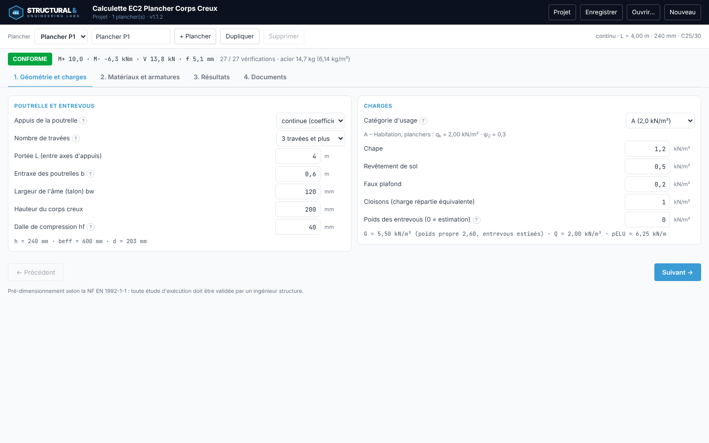
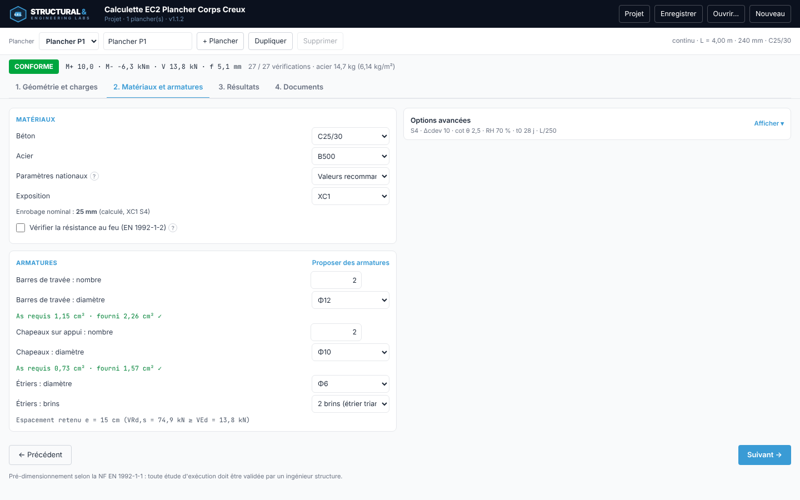
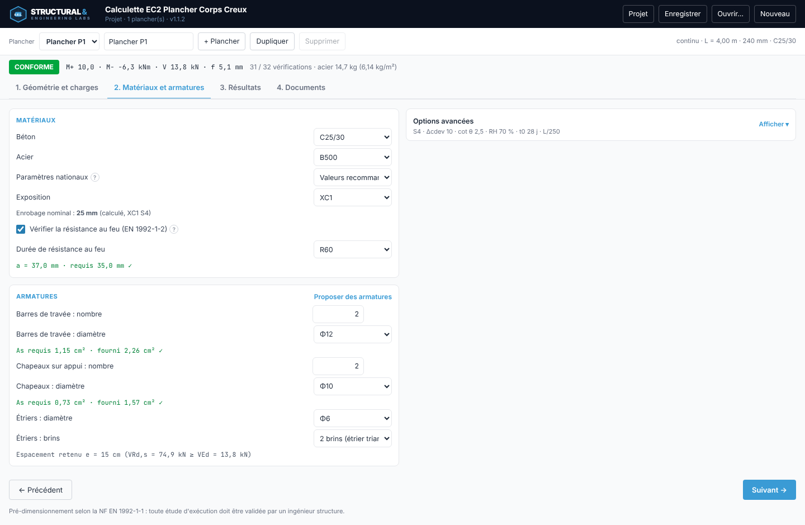
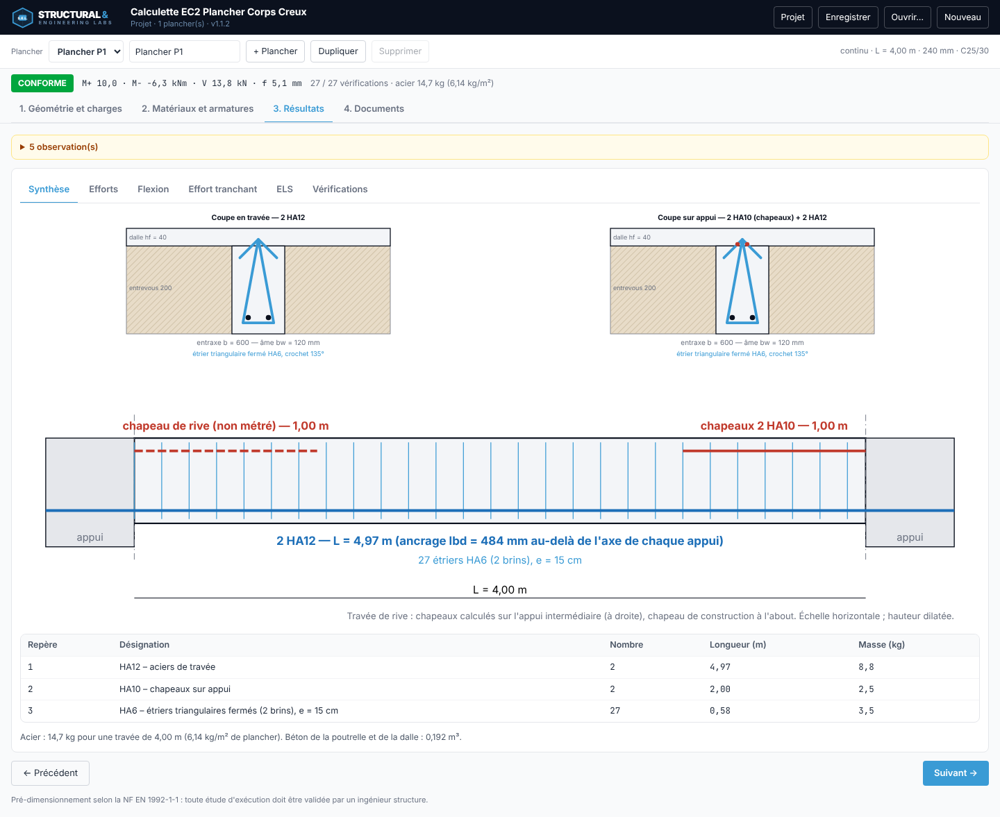
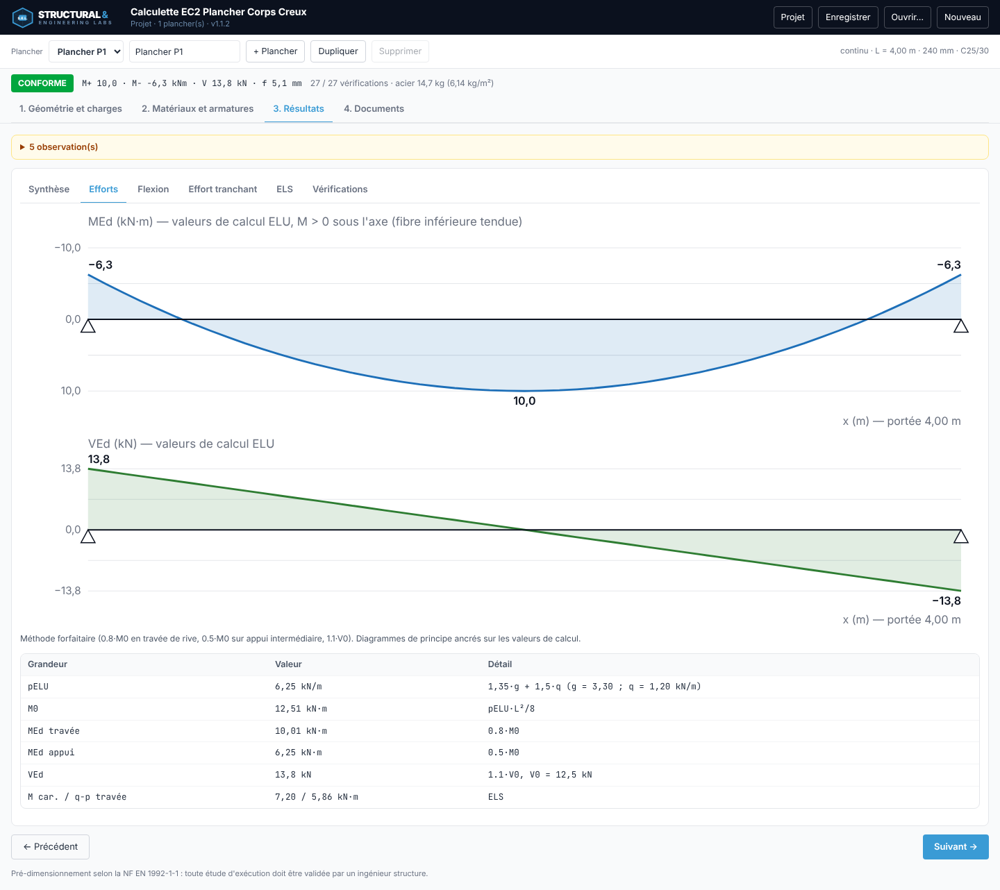
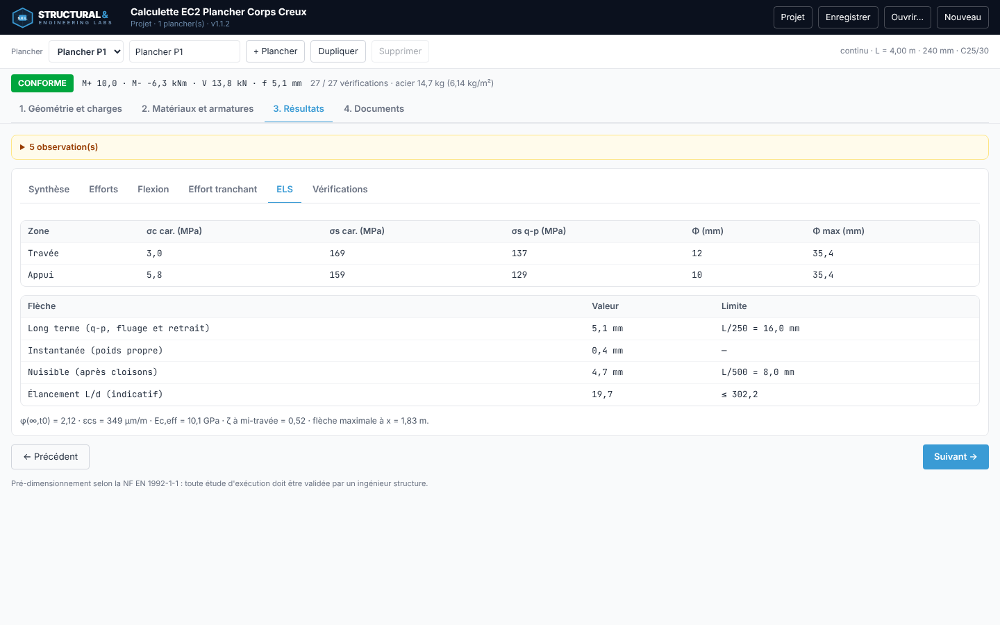
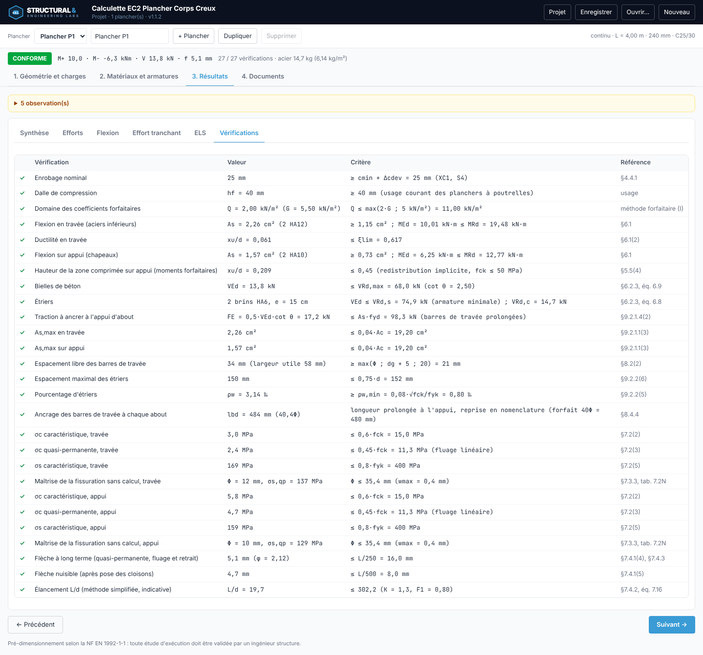
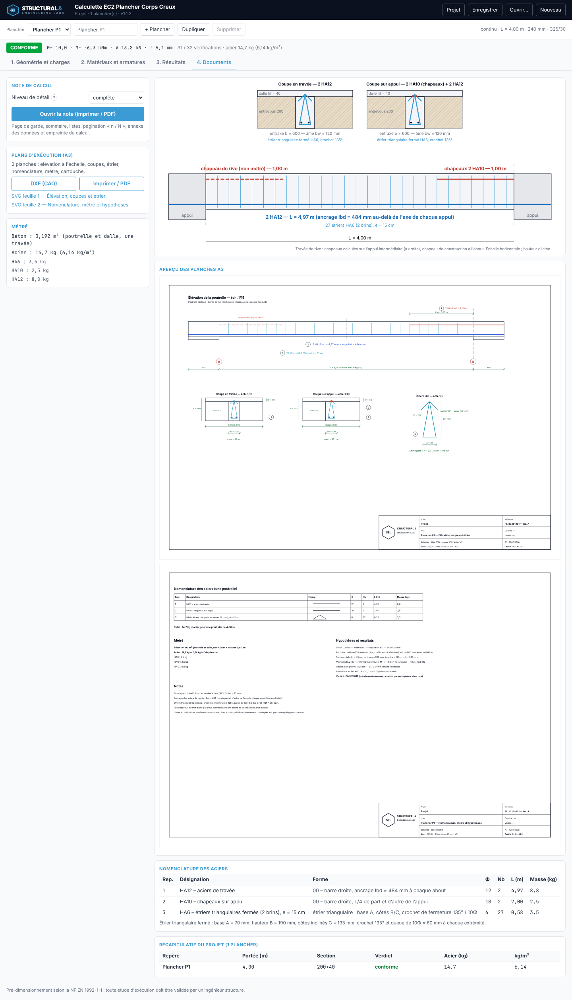
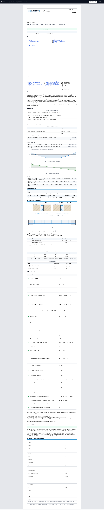

# Manuel d'utilisation — Plancher à corps creux EC2 (v1.1.0)

L'application dimensionne une poutrelle représentative d'un plancher à corps creux selon la NF EN 1992-1-1 et en produit la
note de calcul, la nomenclature et le métré. Le verdict affiché en tête (CONFORME, NON CONFORME, NON VÉRIFIÉ) ne vaut que pour
les vérifications effectuées ; le périmètre est rappelé dans la note.

## 1. Géométrie et charges

- **Appuis** : poutrelle isostatique, ou continue (méthode forfaitaire sur la travée de rive ; 2 travées, ou 3 travées et plus).
- **Portée L** entre axes d'appuis, **entraxe** des poutrelles, **âme bw**, **hauteur du corps creux**, **dalle de compression hf**.
- **Charges** : catégorie d'usage (qk et ψ de l'EN 1991-1-1 ; « Annexe France » : catégorie A à 1,5 kN/m² ; « personnalisée » pour les autres catégories de l'Annexe nationale), chape, revêtement,
  faux plafond, cloisons, poids des entrevous (0 = estimation à remplacer par la fiche du fabricant).

## 2. Matériaux et armatures

- Béton, acier, exposition : l'enrobage nominal est calculé (classe structurale et Δcdev dans les options avancées).
- **Résistance au feu (option)** : case « Vérifier la résistance au feu (EN 1992-1-2) » et durée R30 à R240 ; contrôle tabulé de la nervure (largeur, distance a, barres d'angle) intégré au verdict.
- Armatures de travée, chapeaux (sur appui, ou de construction en isostatique), étriers triangulaires fermés.
- L'indicateur « As requis / fourni » signale tout de suite une section insuffisante ; **Proposer des armatures** retient la
  plus petite section couvrant le besoin avec un espacement libre conforme.

## 3. Résultats

La synthèse présente les coupes en travée et sur appui (étrier triangulaire fermé à crochet 135°), l'élévation de la poutrelle
(ancrages, chapeaux, étriers) et la nomenclature. Les autres onglets détaillent les efforts, la flexion, l'effort tranchant, les ELS
et la liste complète des vérifications.

Une vérification marquée ✗ est bloquante ; ⚠ signale un critère non bloquant (indicatif).

## 4. Documents

- **Note de calcul** complète ou de synthèse : page de garde, sommaire, listes, équations avec leurs valeurs, annexe des données et
  empreinte ; « Imprimer / PDF » produit le PDF paginé.
- **Plans d'exécution A3** : 2 planches (élévation à l'échelle, coupes, étrier, nomenclature, métré, cartouche) en **DXF**, SVG, ou impression / PDF A3.
- **Nomenclature, métré et récapitulatif** de tous les planchers du projet.

## 5. Projet

L'identification (projet, client, référence, rédacteur, vérificateur, indice) se règle sous « Projet ». Le projet est enregistré
automatiquement dans le navigateur ; **Enregistrer** produit un fichier `.plancher.json`, **Ouvrir…** le relit. Plusieurs planchers
peuvent coexister (+ Plancher, Dupliquer, Supprimer).

*Les résultats sont des éléments de pré-dimensionnement : toute étude d'exécution doit être validée par un ingénieur structure.*

Le guide d'utilisation illustré est disponible en PDF : `docs/guide/Guide_utilisateur_Plancher_Corps_Creux_EC2.pdf` (`npm run guide`).
